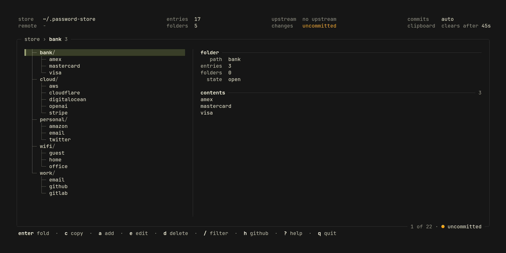
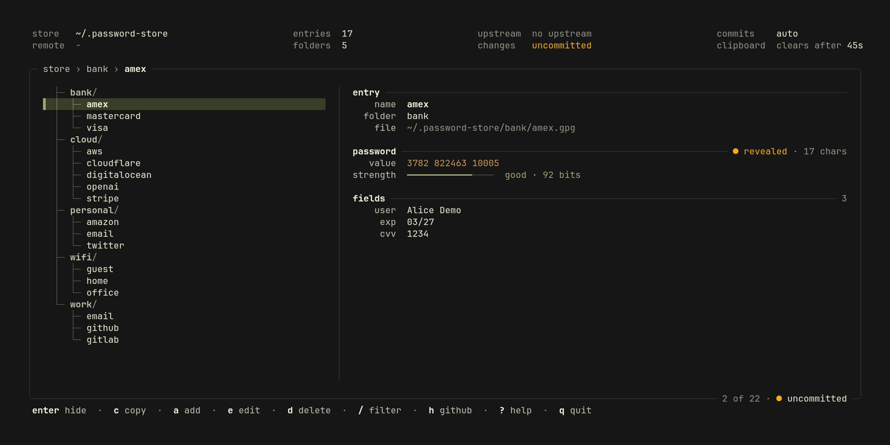
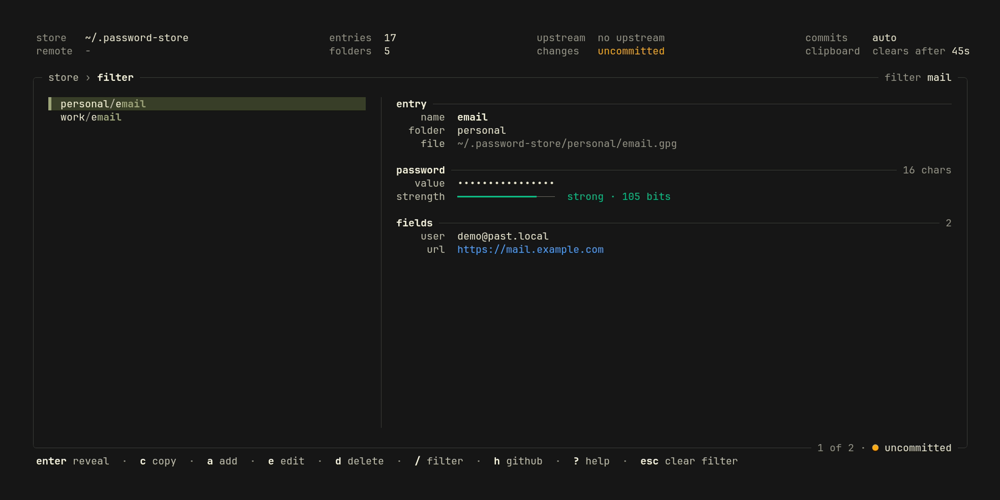
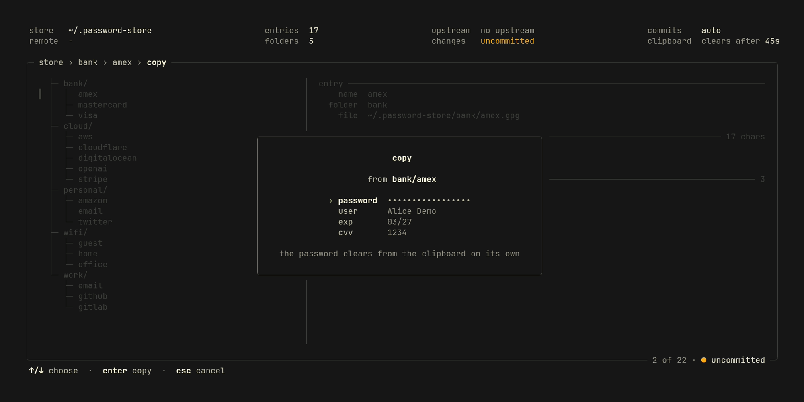
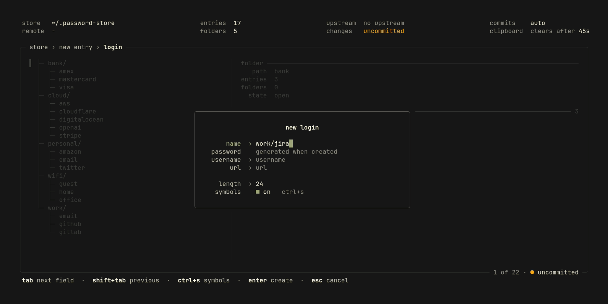
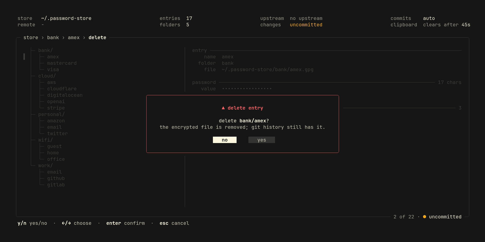
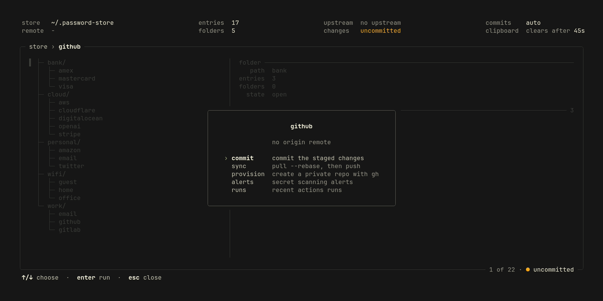
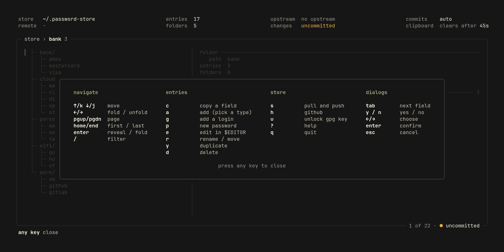

<p align="center">
  <h1 align="center">
    <a href="https://kontrolplane.dev">
      
    </a>
  </h1>
</p>

`past` (pass + tui) is a terminal user interface (tui) application for [`pass`](https://www.passwordstore.org/), the standard unix password manager, with first-class github integration. It wraps your existing `pass`, `git`, `gpg`, and `gh` installs: it never re-implements crypto and never stores secrets itself. Every operation shells out to the tools you already trust, and clipboard copies go through `pass -c`, so pass owns the auto-clear timeout.


## views

- `store`: the entries as a collapsible tree nested under their folders, a filter that flattens it to the matches, and a folder's contents beside it
- `entry`: details with the password masked until revealed, coloured by character class and rated by a strength meter, then its fields and notes; copy a field, create from a type, rename, duplicate, delete
- `github`: commit staged changes, `pull --rebase` and `push`, provision a private repo via `gh`, secret-scanning alerts and recent actions runs

The header shows the store and its remote, how many entries and folders it holds, whether it is ahead of or behind its upstream and has uncommitted changes, whether changes commit on their own, and when the clipboard clears.










## features

- browse, copy, generate, regenerate, add, edit, rename/move, duplicate, and delete entries
- bulk-import from a CSV or XML export: `past import secrets.csv`
- every change auto-commits by default; turn it off (`auto_commit = false`) to stage changes and commit them yourself from the github menu (`h`)
- the git state in the frame (`● synced`, `↑ahead ↓behind`, `● uncommitted`) and one-key `pull --rebase` + `push`
- the same look as [relay](https://github.com/kontrolplane/relay) and [tablespace](https://github.com/kontrolplane/tablespace), in a dark and a light theme

## prerequisites

| tool   | needed for           | install                |
|--------|----------------------|------------------------|
| `pass` | everything           | `brew install pass`    |
| `gpg`  | pass encryption      | `brew install gnupg`   |
| `git`  | sync / status        | (usually preinstalled) |
| `gh`   | github features only | `brew install gh`      |

You also need an initialized store and an authenticated `gh`:

```bash
pass init <your-gpg-id>   # creates ~/.password-store (or $PASSWORD_STORE_DIR)
gh auth login             # only for the github menu
```

`past` shows a friendly setup screen — not a crash — when a prerequisite is missing.

## install

```bash
go build -o past . && ./past
```

`past` honours `$PASSWORD_STORE_DIR` (default `~/.password-store`).

```bash
past --theme auto    # follow the terminal (default)
past --theme dark    # or light: also paints the background
```

## import

Bring entries in from another manager's export, non-interactively:

```bash
past import secrets.csv     # or secrets.xml
```

- **csv** — a header row with a required `name` (or `path`) column and an optional `password` column; every other non-empty cell becomes a `key: value` line, e.g. `name,password,user,url`.
- **xml** — `<store><entry name="folder/x"><password>…</password><user>…</user></entry></store>`; a `<password>` child is the first line, any other child becomes metadata.

Imported entries are written but not committed — review them in the tree and commit from the github menu (`h`) when you're happy.

## keybindings

| key       | action                                  |
|-----------|-----------------------------------------|
| `j` / `k` | move down / up                          |
| `←` / `→` | fold / unfold a folder (`←` on an entry jumps to its folder) |
| `pgup` / `pgdn`, `home` / `end` | page, first / last          |
| `/`       | filter entries                          |
| `enter` / `space` | on a leaf: reveal / mask the password; on a folder: fold / unfold |
| `c`       | copy — password (clears after a timeout) for a single-field entry; otherwise pick a field. the password always clears via pass; other field values are copied as-is and don't auto-clear |
| `g`       | new login (generated password), filled in-app |
| `a`       | new entry — pick a type (login/password/credit card/email/server/database/api token/secure note), fill fields in-app |
| `e`       | edit the selected entry (opens `$EDITOR`)|
| `p`       | regenerate the entry's password in place (keeps metadata) |
| `r`       | rename / move the entry (type a new path) |
| `y`       | duplicate the entry to a new path       |
| `d`       | delete (asks to confirm: `y`, or `←`/`→` and `enter`) |
| `s`       | sync — `pass git pull --rebase` then `push` |
| `h`       | github menu (commit, sync, repo)        |
| `u`       | unlock — enter the gpg passphrase in-app (also prompts automatically on a locked key) |
| `?`       | help (any key closes it)                |
| `q`       | quit                                    |

Inside the github menu: commit staged changes, sync, provision a repo, and view alerts / actions runs. `↑`/`↓` move, `enter` selects, `esc` backs out.

## config

Optional dotfile at `~/.config/past/config` (override with `$XDG_CONFIG_HOME` or `$PAST_CONFIG`). Simple `key = value` lines, `#` comments. Missing file or keys fall back to defaults.

```ini
# commit every change automatically (default: true)
auto_commit = false
```

## a note on secret-scanning

The store holds *encrypted* `.gpg` blobs, so github secret-scanning will almost always report **no alerts** — the value of the panel is confirming the repo is clean and private, not catching leaked plaintext.

## non-goals (v1)

otp/totp, multiple stores, mouse support, and non-github remotes. The git layer is remote-agnostic, but only github gets the `gh`-powered features.

## development

- [go](https://go.dev/) 1.26+

```bash
go build -o past . && ./past
```

To show the changes made in the repository readme, the following command can be ran which records the gif and a screenshot of every page inside a container:

```bash
make vhs
```

## contributors

[//]: kontrolplane/generate-contributors-list

<a href="https://github.com/levivannoort"></a>

[//]: kontrolplane/generate-contributors-list

</br>

<p align="center">
  
</p>
